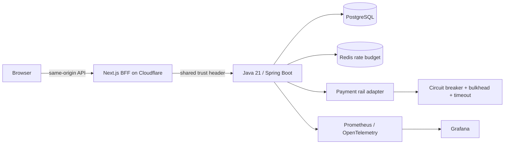

# V-Pulse

### Dependency audit policy (2026-10-18)

Run `npm run audit:dependencies`. Runtime dependencies retain a strict high/critical audit. The full audit uses `audit-ci.json` with one user-approved, exact advisory-and-lint-path exception for GHSA-vfj7-8cjw-p6xm (unpatched braces stack exhaustion), expiring at 00:00 Asia/Bangkok on 2026-11-18. This is accepted risk, not a vulnerability fix or a zero-findings claim. Lint only trusted repository configuration; do not feed untrusted root-directory glob patterns into the lint tool. All other high/critical findings and audit-service failures still block CI. Remove the exception when upstream is patched; do not renew automatically.

Local reconciliation update (2026-10-24): V4 remains fail-closed for unknown outcomes. V5 adds stable references, an independently committed simulator ledger, read-only provider lookup and separate operator confirmation. Verified success resolves locally without another authorization; verified final rejection can grant controlled replay permission only under this simulator's no-execution guarantee. Unknown/unavailable/NOT_FOUND and historical missing references remain blocked. See [implementation and A–E game-day evidence](docs/fde/acceptance-tests.md). This feature branch has not been deployed; historical hosting artifacts do not prove this capability is live. Rollout requires additive V5 and pausing older writers.

V-Pulse is a payment-reliability control plane built as portfolio evidence for backend, cloud-oriented, and full-stack roles. It demonstrates how a team can contain an unhealthy downstream payment rail, park uncertain work, and recover it through an explicit audited replay instead of retrying blindly.

## Live demo

- Application: [v-pulse-payment-ops.vmarket-vietdung2005.workers.dev](https://v-pulse-payment-ops.vmarket-vietdung2005.workers.dev)
- Backend readiness: [v-pulse-api.onrender.com/actuator/health/readiness](https://v-pulse-api.onrender.com/actuator/health/readiness)
- Public deployment proof: [docs/evidence/live-deployment.md](docs/evidence/live-deployment.md)
- Short-lived AWS deployment proof: [docs/evidence/aws-deployment.md](docs/evidence/aws-deployment.md)

The backend uses Render's free web-service tier, so the first request after 15 minutes without inbound traffic can take about a minute while the container wakes up.

## Architecture



The browser never receives BFF or operations credentials. The Spring service uses short database transactions around state transitions; it does not hold a connection while waiting for a rail. A failed or timed-out authorization is persisted in the parking queue, while an interrupted `PROCESSING` instruction is recovered by a scheduled reconciler.

## What is implemented

- Java 21 virtual-thread rail calls with a 250 ms timeout, per-rail semaphore bulkhead, and Resilience4j circuit breaker.
- PostgreSQL state machine, Flyway migration, attempt history, parking queue, operator audit events, atomic replay claim, and stalled-work recovery.
- Atomic Redis Lua rate budget with an availability-preserving fail-open policy and metrics.
- Spring Boot Actuator health probes, Prometheus metrics, OpenTelemetry bridge, and a provisioned Grafana dashboard.
- Next.js 16 BFF allow-list, server-only credential injection, strict CSP, and a responsive incident control plane.
- Non-root multi-stage Docker image, local Compose stack, and a Helm chart with probes, limits, HPA, PDB, NetworkPolicy, and hardened pod security context.
- Testcontainers integration tests, Vitest unit tests, Playwright operator-flow tests, dependency audit, and four-lane CI.

## Run locally

Prerequisites: Node.js 22, Java 21, and Docker.

```bash
cp .env.example .env.local
docker compose up --build -d
npm ci
npm run dev
```

Open `http://localhost:3000`; Prometheus is at `http://localhost:9090` and Grafana at `http://localhost:3001` (`admin` / `vpulse-local`). Demo seed data is enabled only by Compose; it defaults off in the application.

### Operator access (local remediation branch)

The public dashboard is read-only. Creating simulated payments, changing rail faults, and replaying parked work require an authenticated `OPERATOR` session and a CSRF token. Operators are explicitly trusted across this single demo dataset; merchant-scoped self-service accounts are not exposed. A caller cannot gain this role by choosing a `merchantId` or sending an operations service secret.

Migration V2 adds PostgreSQL accounts, login windows, and durable Spring Session tables. Set `AUTH_BOOTSTRAP_USERNAME` and `AUTH_BOOTSTRAP_PASSWORD_HASH` (BCrypt) in the **backend process environment** to provision the initial operator. Both blank means no default account. Existing accounts are not overwritten; never publish operator credentials. Spring does not automatically load Next.js `.env.local`.

Cookies are HttpOnly, SameSite=Lax and Secure by default; production rejects `AUTH_SECURE_COOKIE=false`. Set false only for local HTTP (Compose does this). Session idle timeout is 15 minutes. Disabling an account or changing its database role takes effect on its next request; there is no public signup/password recovery workflow.

Login is limited to 10 attempts/minute per backend peer address in PostgreSQL. A shared BFF may share that budget: this is not a per-end-user-IP limiter, and arbitrary forwarded-IP headers are not trusted. Use HTTPS and platform ingress limits in production.

For a real frontend → BFF → Java → PostgreSQL browser check, run backend verify and frontend build **before** this command; do not rebuild concurrently:

```powershell
pwsh -NoProfile -File tools/verify-operator-session.ps1
```

The script creates disposable local PostgreSQL/Redis containers and removes them afterwards. It does not touch production. See [local remediation evidence](docs/evidence/remediation-2026-10-18.md); live links above still represent the earlier deployed version until coordinated rollout.

## Verification

### Merchant operation identity (local, not yet deployed)

Payment create now requires `Idempotency-Key` (8–120 ASCII identifier characters). Merchant IDs are trimmed/uppercased before lookup, fingerprinting and quota. V3 atomically stores the key/request hashes, instruction reference and received audit; historical instructions are preserved without fabricated operation identities. Matching duplicates do not call the gateway or consume a new create quota unit; changed payment details return 409. A pending duplicate returns the same instruction with 202, terminal duplicate 200, and a newly completed create 201.

The browser saves a UUID and canonical payment payload before sending, preserves them on failed/unverified/PROCESSING responses, and retries the same key after reload only on explicit submission. Edited details cannot reuse an unresolved intent. Storage failures/corruption fail closed. No login cookie, CSRF token or service credential is stored there. Form restoration/recovery guidance is still basic; deleting/cloning storage or switching devices is not account recovery. The ledger is retained with business instructions, not expired to permit re-execution.

This prevents duplicate **local create** operations, not duplicate provider settlement. The simulated provider now supports stable references, immutable outcome lookup, accepted-but-response-lost reconciliation and expiring investigation claims. Its ledger is independent of local payment state/commit but shares the same database availability domain. Existing payment stale-work recovery remains a two-minute scan, not a general durable worker lease system. Do not infer that a healthy rail makes an unknown earlier outcome safe to replay.

Before rollout: stop old writers/pause mutations, back up and apply additive migrations through V5, deploy matching backend/BFF/client, then smoke. Old clients without a key get 400; mixed-version zero-downtime rollout is not promised. Rerun dependency audit before deployment; the latest local run is a snapshot, not a permanent security guarantee. No new platform keys are needed for this local work.

```bash
npm run verify
npm run test:e2e
cd backend && ./mvnw verify
docker compose config --quiet
helm lint infra/helm/vpulse
```

The local browser suite starts on `127.0.0.1:3207`; set `PLAYWRIGHT_PORT` to override that port or `PLAYWRIGHT_BASE_URL` to test an existing deployment.

See [pain-point evidence](docs/PAIN_POINT_PROOF.md), [architecture decisions](docs/ARCHITECTURE.md), [incident runbook](docs/RUNBOOK.md), and the [game-day postmortem](docs/POSTMORTEM.md).
