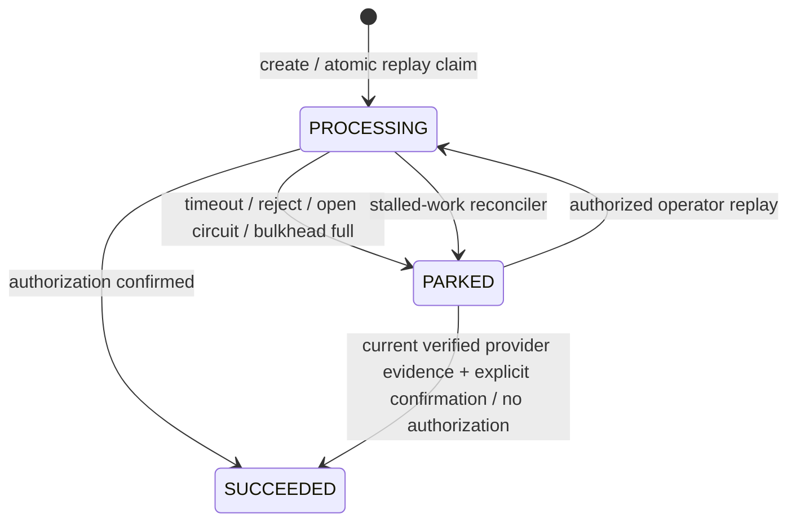

# Architecture decisions

## Reconciliation implementation — 2026-10-24

The [incident brief](fde/customer-incident-brief.md) maps the baseline gaps and delivered feature. The [contract](fde/payment-reconciliation-contract.md) defines stable provider identity, independent simulator commit, read-only lookup and separate explicit confirmation. Additive V5 and the investigation drawer are implemented locally, not deployed. See [test evidence](fde/acceptance-tests.md) before making capability claims.

## Local remediation update — 2026-10-18

V4 adds explicit replay permission, default false even for historical rows. Only final/no-execution simulator rejection or calls prevented by circuit/bulkhead grant permission. Replay first locks the instruction, then reads permission in a fresh READ COMMITTED statement. A joined snapshot read before waiting can incorrectly retain old permission. Claim consumes permission atomically; interrupted-work recovery revokes it. V5 lookup also revokes permission while investigating; current verified rejection requires separate confirmation to grant it again. Unknown/unavailable/NOT_FOUND remains blocked; verified success can be explicitly resolved locally without another authorization.

Rollout requires pausing old writers, backup, additive migrations through V5, then matching backend/BFF/client. Old writers must not bypass permission or provider-reference semantics. These are local changes, not deployment evidence.

## ADR-001 — Park uncertain work instead of automatic retry

Payment authorization can have an ambiguous outcome after a timeout. V-Pulse records an attempt and moves the instruction to `PARKED`. Parking makes uncertainty visible; it does **not** prove it is safe to authorize again. Simulated provider lookup can now establish a prior authorization using the original persisted reference. It never submits authorization; resolution is a separate audited decision. Real provider identity/finality and financial effects remain unproven.

## ADR-002 — Short transactions around external I/O

The service commits instruction/create identity atomically, releases that business transaction, calls the adapter, then finalizes in a new transaction. Provider I/O holds no payment business transaction/row lock. The simulator itself uses a short independently committed ledger transaction; its read-only lookup transaction may contain the configured demo delay. Configuration/quota/DB waiting still need additional bounds; this is not a blanket guarantee against pool exhaustion. Stale PROCESSING recovery remains a two-minute scan; the new 30-second lease applies to reconciliation claims, not all payment workers.

## Merchant-scoped create identity (local remediation)

POST create requires an 8–120-character Idempotency-Key. V3 stores merchant scope, domain-separated key/request hashes and a unique instruction reference in one transaction with the initial instruction and PAYMENT_RECEIVED audit. Canonical merchant identity is trimmed/uppercased with Locale.ROOT, then validated as a bounded ASCII identifier; rail/amount/currency are included in the fingerprint. A per-key transaction advisory lock serializes lookup + claim; unique constraints remain the database backstop. Quota is consulted only for a new operation, after duplicate detection. It is still a global operator demo dataset, not merchant self-service authorization.

Only the winning creator invokes the gateway after commit. A duplicate with matching payload reads the same resource without invoking it again: PROCESSING returns 202, observed terminal duplicates 200; a new terminal result returns 201. Mismatched content returns 409. Current state/attempts may evolve after replay; this is not byte-identical response storage or a fully atomic multi-query read snapshot. The identity ledger is retained with its instruction, with no expiry that silently permits execution again. Historical instructions receive no invented key or fingerprint.

The browser records version/UUID/canonical payment payload in sessionStorage before POST. It validates responses, retains the intent after errors/PROCESSING, blocks changed details, and only clears matching metadata after a verified non-PROCESSING instruction response. Reload does not automatically POST; an explicit identical retry performs the backend lookup. No session cookie/CSRF/service secret is stored in the intent. This does not survive deliberate storage deletion or provide cross-device recovery; UI restoration/recovery guidance remains limited. The API requires a key even for old clients, so coordinated rollout is required.

## ADR-003 — Redis limiter fails open

Redis protects a rail from merchant bursts, but Redis unavailability must not become a global payment outage. The limiter therefore fails open and increments `vpulse.rate_limit{outcome="redis_error"}`. A real organization should connect this signal to paging and may choose fail-closed for a high-risk endpoint.

## ADR-004 — BFF is a narrow trust boundary

The browser can call only allow-listed payment-control paths. The BFF creates backend authentication and operations headers from server runtime secrets; it forwards only approved session/CSRF/content headers and the original create operation key. Mutating demo controls and replay require the separate operations secret in addition to an authenticated operator session.

## Data states

Known production extensions are intentionally outside this portfolio scope: real rail adapters, merchant identity/authentication, multi-region consensus, and a durable message broker. They are not silently represented by mocks.

## ADR-005 — Lookup is not authorization

V5 adds stable per-attempt provider references, an independently committed simulator ledger and durable investigation evidence. A bounded lookup commits an expiring claim before read-only provider I/O, releases business locks, then records the observation under version/reference/lease fencing. Only a separate explicit operator confirmation can resolve verified success locally or grant controlled replay for a final/no-execution rejection. Neither lookup nor confirmation calls authorization. Unknown, unavailable, NOT_FOUND and historical missing-reference cases remain fail-closed. See the [transaction contract](fde/payment-reconciliation-contract.md) and [executed evidence](fde/acceptance-tests.md). The same-database simulator does not prove independent provider availability or settlement.

## Adapter compatibility note

Next.js 16 names request interception `proxy.ts` and runs it on Node.js. OpenNext Cloudflare 1.20.2 rejects Node proxy bundles and still requires edge `middleware.ts`. V-Pulse deliberately keeps the deprecated filename for nonce-based CSP until the adapter supports the new convention; `npm run cf:build` is a CI gate so this compatibility shim cannot silently break.
