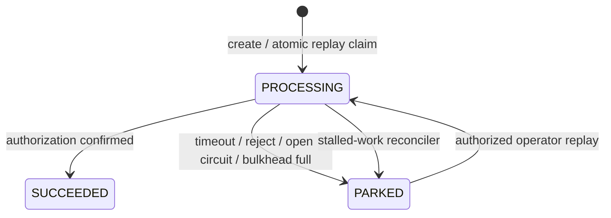

# Architecture decisions

## Local remediation update — 2026-10-18

V4 adds explicit replay permission, default false even for historical rows. Only explicit simulator rejection or calls prevented by circuit/bulkhead grant permission. Replay first locks the instruction, then reads permission in a fresh READ COMMITTED statement. A joined snapshot read before waiting on the lock can incorrectly retain an earlier attempt's permission. Claim consumes permission atomically; interrupted-work recovery revokes it. Unknown outcomes return 409 PAYMENT_RECONCILIATION_REQUIRED without calling the rail. Provider lookup/manual reconciliation is not implemented; leave unknown instructions parked.

Rollout requires pausing old writers, backup, additive V3/V4 migrations, then matching backend/BFF/client. Old writers must not bypass the guard. These are local changes, not deployment evidence.

## ADR-001 — Park uncertain work instead of automatic retry

Payment authorization can have an ambiguous outcome after a timeout. V-Pulse records an attempt and moves the instruction to `PARKED`. Parking makes uncertainty visible; it does **not** prove it is safe to authorize again. The current replay action exercises a simulator. Stable provider references, provider-side deduplication/status lookup and reconciliation remain a deployment gate before claiming recovery without duplicate financial effects.

## ADR-002 — Short transactions around external I/O

The service commits an instruction/create identity atomically, releases that transaction, calls the downstream adapter, then finalizes in a new transaction. The provider call itself holds no JDBC transaction. Configuration/quota/DB waiting still need additional bounds; this is not a blanket guarantee against pool exhaustion. A reconciler currently converts stale `PROCESSING` records to `PARKED` after two minutes, not by a full claim/lease protocol yet.

## Merchant-scoped create identity (local remediation)

POST create requires an 8–120-character Idempotency-Key. V3 stores merchant scope, domain-separated key/request hashes and a unique instruction reference in one transaction with the initial instruction and PAYMENT_RECEIVED audit. Canonical merchant identity is trimmed/uppercased with Locale.ROOT, then validated as a bounded ASCII identifier; rail/amount/currency are included in the fingerprint. A per-key transaction advisory lock serializes lookup + claim; unique constraints remain the database backstop. Quota is consulted only for a new operation, after duplicate detection. It is still a global operator demo dataset, not merchant self-service authorization.

Only the winning creator invokes the gateway after commit. A duplicate with matching payload reads the same resource without invoking it again: PROCESSING returns 202, observed terminal duplicates 200; a new terminal result returns 201. Mismatched content returns 409. Current state/attempts may evolve after replay; this is not byte-identical response storage or a fully atomic multi-query read snapshot. The identity ledger is retained with its instruction, with no expiry that silently permits execution again. Historical instructions receive no invented key or fingerprint.

The browser records version/UUID/canonical payment payload in sessionStorage before POST. It validates responses, retains the intent after errors/PROCESSING, blocks changed details, and only clears matching metadata after a verified non-PROCESSING instruction response. Reload does not automatically POST; an explicit identical retry performs the backend lookup. No session cookie/CSRF/service secret is stored in the intent. This does not survive deliberate storage deletion or provide cross-device recovery; UI restoration/recovery guidance remains limited. The API requires a key even for old clients, so coordinated rollout is required.

## ADR-003 — Redis limiter fails open

Redis protects a rail from merchant bursts, but Redis unavailability must not become a global payment outage. The limiter therefore fails open and increments `vpulse.rate_limit{outcome="redis_error"}`. A real organization should connect this signal to paging and may choose fail-closed for a high-risk endpoint.

## ADR-004 — BFF is a narrow trust boundary

The browser can call only allow-listed payment-control paths. The BFF creates backend authentication and operations headers from server runtime secrets; it forwards only approved session/CSRF/content headers and the original create operation key. Mutating demo controls and replay require the separate operations secret in addition to an authenticated operator session.

## Data states

Known production extensions are intentionally outside this portfolio scope: real rail adapters, merchant identity/authentication, multi-region consensus, and a durable message broker. They are not silently represented by mocks.

## Adapter compatibility note

Next.js 16 names request interception `proxy.ts` and runs it on Node.js. OpenNext Cloudflare 1.20.2 rejects Node proxy bundles and still requires edge `middleware.ts`. V-Pulse deliberately keeps the deprecated filename for nonce-based CSP until the adapter supports the new convention; `npm run cf:build` is a CI gate so this compatibility shim cannot silently break.
