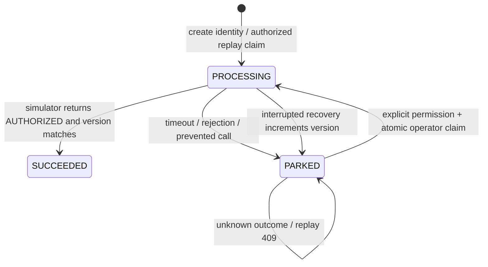

# Payment reconciliation contract: current boundary and future design

## Current contract — implemented

- Merchant create idempotency is local: identical merchant/key/payload returns the original instruction without another gateway call; payload mismatch conflicts. PROCESSING duplicates may return 202, observed terminal duplicates 200. It is not provider-side deduplication.
- Replay requires an authenticated OPERATOR, CSRF, server-injected BFF/ops secrets and `parked_payment.replay_permitted=true`.
- The instruction is locked first; permission is read in a fresh statement after lock acquisition. Claim consumes permission and increments the instruction version in the same transaction.
- Only explicit **simulator** rejection, circuit prevention or bulkhead prevention grants permission. TIMEOUT, OUTCOME_UNKNOWN, PROCESS_INTERRUPTED and unproven historical rows remain blocked.
- The external-like wait holds no business transaction. Finalization changes only PROCESSING with the claimed version. A late result cannot overwrite recovery's newer version.
- There is **no provider lookup API, authoritative independent provider ledger, stable provider reference or operator resolution API**. Current GET detail is a local observation only.

## Safety invariants — preserve in any future implementation

1. A timeout is neither rejection nor evidence of non-execution.
2. Provider NOT_FOUND is unknown unless a separately documented, strong no-execution guarantee applies; absence alone never permits authorization.
3. Local reconciliation must not issue another authorization. Verified success would resolve local state using the original external operation's evidence.
4. A provider rejection is actionable only under that provider's finality/no-execution semantics. A new attempt is a separate authorized decision, not an implicit side effect of lookup.
5. Evidence must bind to the original operation/reference and request identity. Never invent a historical reference or adopt a different operation's result.
6. Concurrent/stale operators must not apply conflicting decisions. Permissions are consumed atomically and unknown results fail closed.
7. Every recovery decision needs authenticated actor, time, reason and evidence provenance. Existing local audit is not provider proof.

## Future design — NOT IMPLEMENTED

A provider adapter would expose an outcome lookup separate from authorization. Proposed outcomes: VERIFIED_SUCCESS, VERIFIED_REJECTION, UNKNOWN, UNAVAILABLE and NOT_FOUND. A definitive NOT_EXECUTED state may exist only if the provider guarantees no late execution and its identity/finality contract supports a safe next attempt.

The adapter would persist a stable external operation identity before first submission and use a documented provider idempotency key scoped to the correct request. An authoritative simulated-provider ledger would be separate from local payment status and commit independently; it must support accepted-but-response-lost. A same-database simulation would still not prove real distributed-provider availability or settlement semantics.

Proposed workflow:

1. Authorize operator and atomically claim a bounded reconciliation investigation for the original instruction/reference; persist in-progress evidence before I/O.
2. Release business locks, perform a bounded **lookup only**, sanitize and record provider observation/error durably.
3. Let the operator review evidence and explicitly confirm a supported local resolution.
4. Reacquire instruction/evidence locks, check original operation and version/claim freshness, then atomically persist the resolution and operator audit. Verified success must not call authorization again.
5. If interrupted, retain uncertainty and evidence; a new bounded investigation can repeat lookup, not authorization. Late results cannot overwrite a newer decision.

These are design requirements, **not available routes or state transitions**. The acceptance gates in [acceptance-tests](acceptance-tests.md) must pass before changing replay policy. No new migration is supplied in this documentation-only change.
