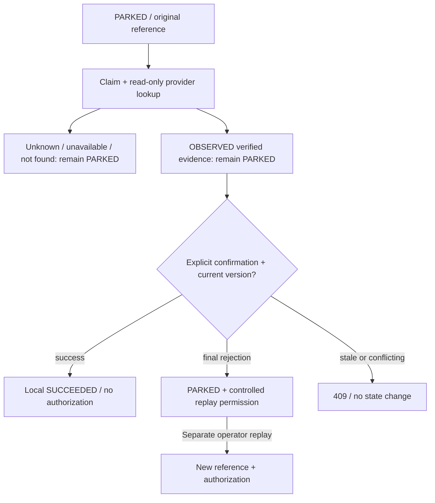

# Simulated provider reconciliation contract

Implemented on `feat/provider-reconciliation` from `0e92e45`. Supersedes the documentation-only design at that base. No real provider, charges or settlement.

## Identity and provider semantics

- Merchant create identity remains local: merchant + operation-key hash + canonical request hash. Matching duplicates return the original instruction without calling the gateway. Retain the original key after an uncertain acknowledgement.
- A winning create/replay claim persists `provider_reference = vpulse:{instruction UUID}:{claimed version}` **before** authorization. Each separately permitted replay has a new reference. Recovery retains the original reference even when incrementing the local version.
- `SimulatedPaymentProvider` commits a ledger in a separate REQUIRES_NEW transaction. It has no FK to local payment status; local finalization rollback cannot erase its result. Both still share one PostgreSQL deployment: this does not prove independent provider availability.
- Same reference + identical operation returns the immutable ledger outcome. A changed payload throws and is treated as unknown, not a final rejection. The fingerprint binds rail, merchant, amount and currency. `authorization_calls` counts invocations, not settlements.
- NORMAL records AUTHORIZED. REJECT records final REJECTED with the simulator-only guarantee **no execution and no late acceptance**. ACCEPT_LOST commits AUTHORIZED then withholds the response past the 250 ms response wait. TIMEOUT records INCOMPLETE, never a no-execution guarantee.
- Lookup maps AUTHORIZED → VERIFIED_SUCCESS; final REJECTED → VERIFIED_REJECTION; incomplete/mismatch → UNKNOWN; absent → NOT_FOUND; errors/deadline/capacity → PROVIDER_UNAVAILABLE. NOT_FOUND never permits replay. Historical records get no fabricated reference or permission.

## Protected API

The existing allowlisted BFF exposes these under `/api/control/`. Investigation GET requires OPERATOR plus server-injected BFF/ops trust. POST also requires session/role and CSRF. Browser-supplied service headers are not trusted.

| Backend route | Meaning |
| --- | --- |
| GET /api/payments/{number}/investigation | Consistent local snapshot, original reference, permission, next action, latest 20 investigations and 50 audits |
| POST /api/payments/{number}/reconciliation | Claim and look up the original operation; 202 for another live claim, otherwise 200 evidence; never authorize or resolve |
| POST /api/payments/{number}/reconciliation/{id}/resolve | Confirm current verified evidence only; no arbitrary target-state body; repeat returns the same evidence |
| POST /api/parking/{number}/replay | Existing separately authorized atomic attempt; permission required and consumed |
| POST /api/demo/rails/{rail}/lookup-profile | Audited simulator fault configuration: NORMAL/UNKNOWN/UNAVAILABLE, delay 0–5000 ms |

## Transaction and state design

1. Lock instruction. Reuse live claim or matching verified evidence. Mark an expired claim INTERRUPTED. Revoke replay permission; commit IN_PROGRESS evidence with actor, request ID, original reference/version and a 30-second database-clock lease.
2. Release business transaction/locks. Perform **lookup only**, with four actual-worker permits and a 3-second response deadline. A worker keeps its permit until it finishes; no unbounded lookup task queue. Simulator read transaction timeout: 5 seconds.
3. Lock instruction again. Require PARKED, matching reference/version and valid lease. Persist OBSERVED result/error and audit atomically. Late/expired lookup becomes INTERRUPTED and cannot grant permission.
4. Explicit confirmation checks evidence ownership, version, reference and verified outcome under the instruction lock. Success → local SUCCEEDED/version increment + remove parking. Final rejection → PARKED/version increment + replay permission. RESOLVED evidence and audit commit atomically. **Neither branch authorizes.**
5. A separate replay locks instruction, rereads permission after acquiring the lock, consumes it and increments version/reference atomically. Original finalization still requires PROCESSING + claimed version. A new uncertain result never inherits old permission.

## Failure boundary

IN_PROGRESS is durable before lookup. A killed process cannot resolve it. After lease expiry, another explicit lookup marks the old claim INTERRUPTED and reads the original operation. There is no automatic financial retry. Database failure before observation leaves the committed claim as recovery evidence; database/transaction errors return sanitized 503. Refresh the original resource, not a replacement payment.

V5 is additive; V1–V4 are unchanged. Stop older writers during rollout/rollback: an old binary cannot maintain the reference contract. Do not backfill historical references or permissions from reason labels. See [decisions](recovery-decision-matrix.md), [tests](acceptance-tests.md) and [handoff](operations-handoff.md).
